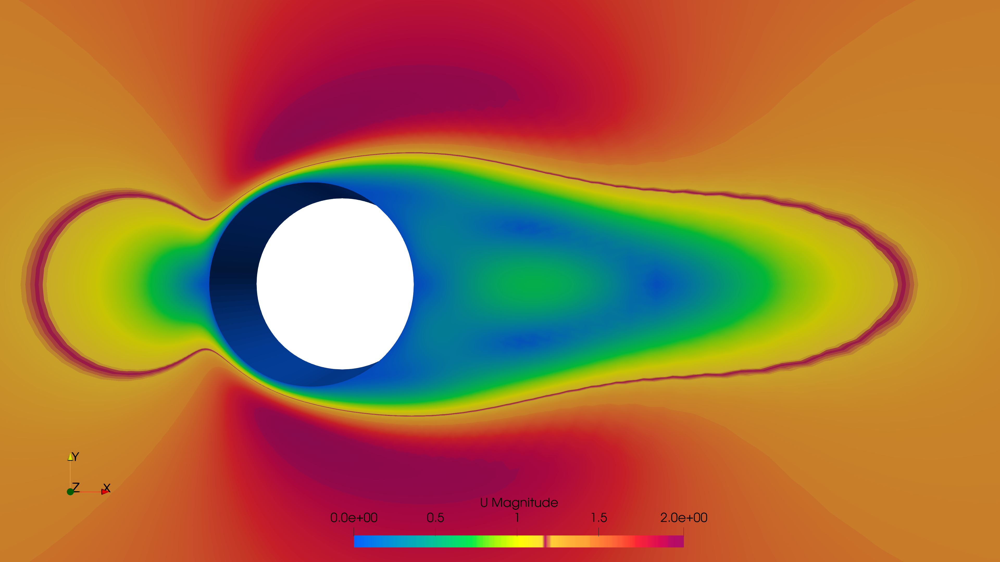
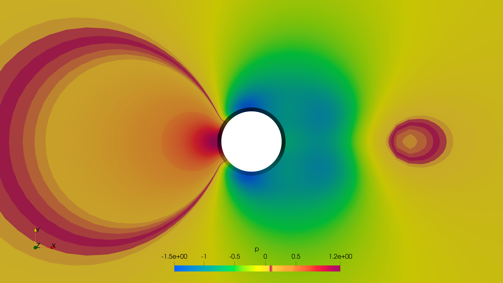
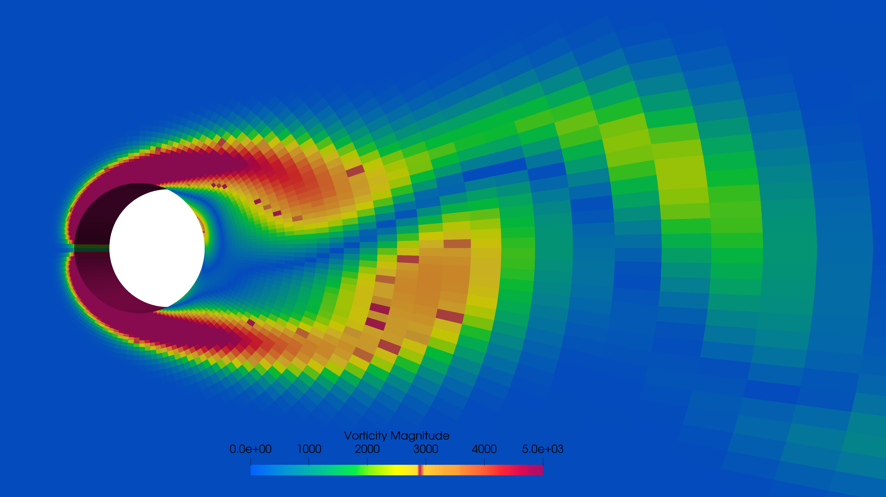
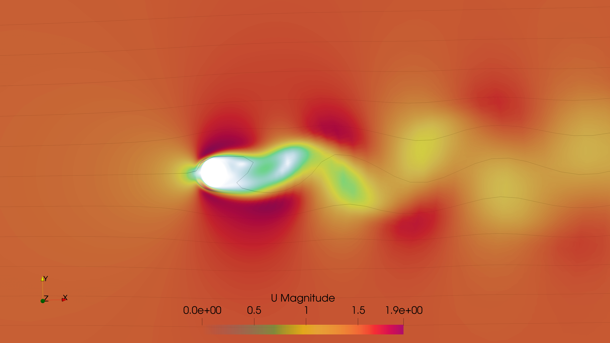
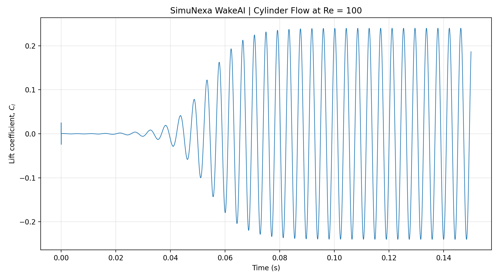

# SimuNexa WakeAI | 2D Unsteady Flow Over a Circular Cylinder (Re = 100)

**CFD Simulation | OpenFOAM-14 | ParaView 5.11.2**

## 1. Project Overview

This project investigates two-dimensional unsteady incompressible flow over a circular cylinder at a Reynolds number of 100 using OpenFOAM-14.

The study focuses on flow separation, wake development, vortex shedding, velocity distribution, pressure distribution and aerodynamic force characteristics.

## 2. Objectives

- Simulate unsteady flow around a circular cylinder.
- Visualize velocity and pressure distributions.
- Investigate wake development and vortex structures.
- Examine velocity streamlines and vorticity distribution.
- Analyze the lift coefficient history and its oscillatory behaviour.

## 3. Software and Tools

| Tool | Application |
|---|---|
| OpenFOAM-14 | CFD simulation |
| ParaView 5.11.2 | Flow visualization and post-processing |
| Python | Data processing and plotting |

## 4. Simulation Parameters

| Parameter | Value |
|---|---|
| Geometry | Circular cylinder |
| Flow type | 2D unsteady incompressible flow |
| Reynolds number | 100 |
| CFD software | OpenFOAM-14 |

## 5. Simulation Results

### 5.1 Computational Mesh

### 5.2 Velocity Magnitude Contour

### 5.3 Pressure Contour

### 5.4 Vorticity Magnitude

### 5.5 Velocity Streamlines

### 5.6 Lift Coefficient History

## 6. Key Observations

- Flow acceleration and deceleration occur around the cylinder.
- A downstream wake develops behind the cylinder.
- The wake exhibits unsteady vortex structures.
- The lift coefficient shows oscillatory behaviour as the unsteady flow develops.

## 7. Project Significance

This project demonstrates an OpenFOAM-based CFD workflow for external flow analysis, including computational mesh visualization, transient flow-field analysis and aerodynamic force-history interpretation.

**Developed under: SimuNexa | CFD and Engineering Simulation**
